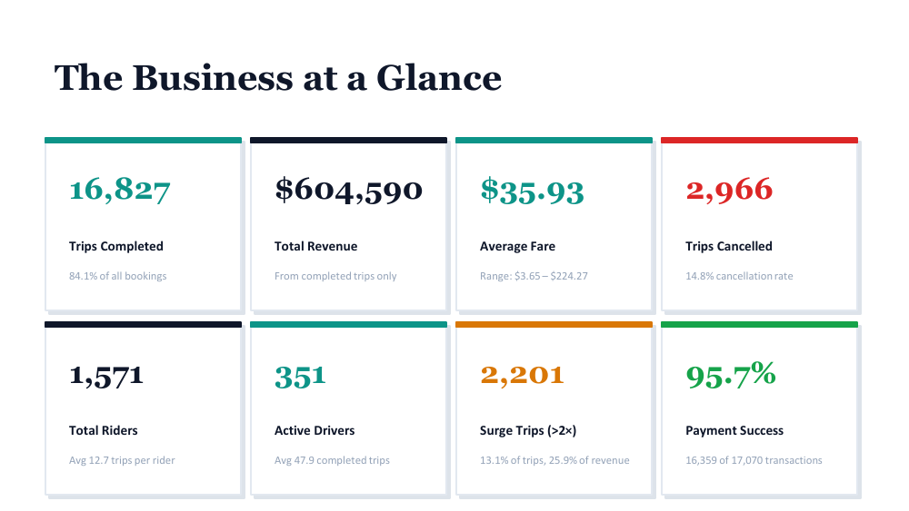
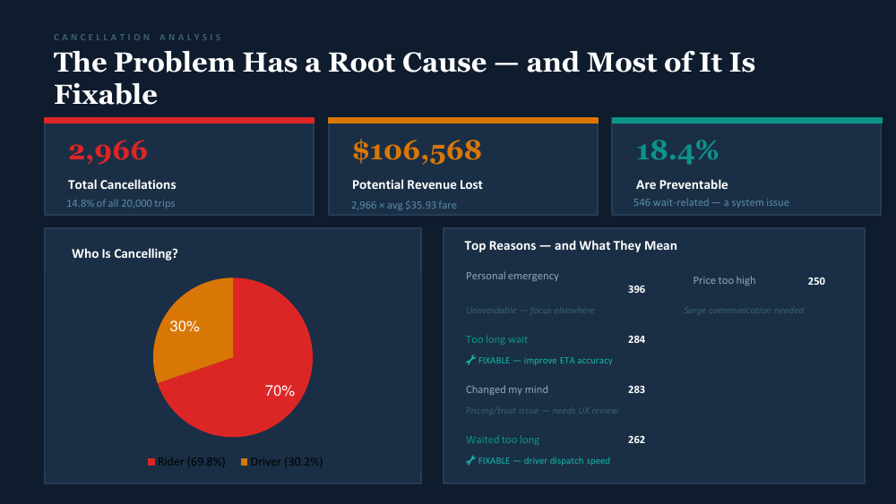
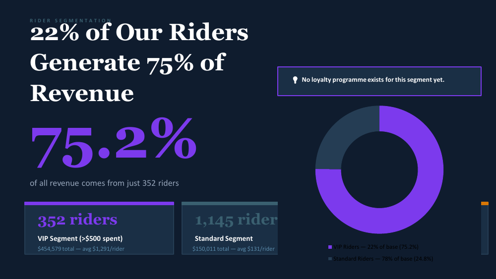
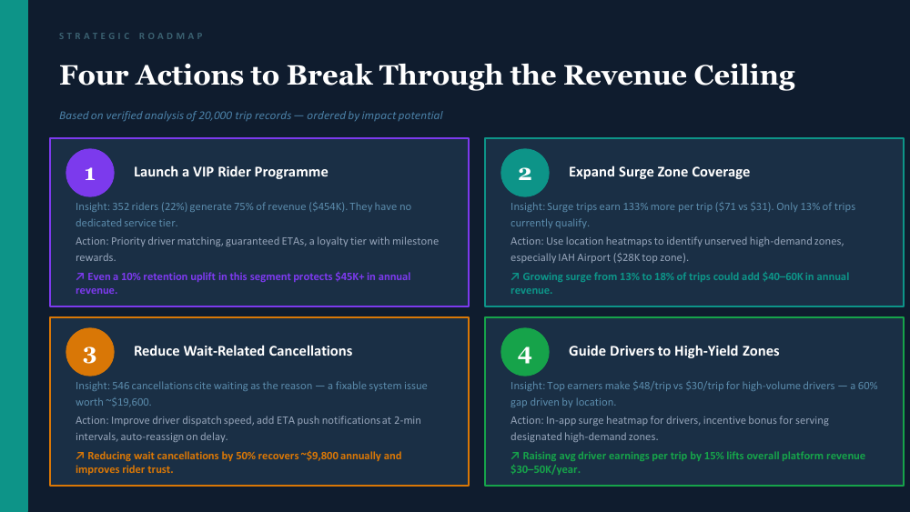

# Uber Trip Analysis: SQL Analysis and Business Intelligence Report


I answered 22 business questions on a ride-sharing database with SQL, then turned the results into a business report with findings and four recommendations.



**Full report:** [`report/Uber_Business_Report.pdf`](report/Uber_Business_Report.pdf) · **Queries:** [`sql/trip_analysis_queries.sql`](sql/trip_analysis_queries.sql)

---

## Business Problem

A ride-sharing platform has operational problems and wants deeper insight into its metrics. Which riders and zones drive revenue, why do trips get cancelled, and how do surge pricing and driver allocation affect results?

---

## Dataset

| | |
|---|---|
| Trips | 20,000 (16,827 completed, 2,966 cancelled, the rest in progress) |
| Cities | Houston, Los Angeles, New York, Chicago |
| Period | January 2022 to June 2024 |
| People | 1,571 riders, 351 active drivers |
| Tables | users, drivers, riders, locations, trips, payments, reviews, cancellations |

<!-- VERIFY: say here whether the dataset is real or synthetic and where it came from. The report calls the trips "real"; remove that word if the data was provided as a training dataset. -->
<!-- ADD: the database script (Wasalny_Database.sql arrived empty) or a link to the dataset, in a data/ folder. -->

---

## What I Did

- Explored the tables for missing values and unusual records (for example, trips with no completion time and a review table with a comment issue).
- Wrote **22 SQL queries** that answer the business questions: top trips and drivers, revenue by month and by pickup zone, payment methods and failed payments, cancellations by who and why, rider spend, and driver earnings.
- Used joins, `GROUP BY` and `HAVING`, aggregate functions, `DISTINCT`, date functions and `TOP` to rank results.
- Combined the results into a business report: [`report/Uber_Business_Report.pdf`](report/Uber_Business_Report.pdf).

<!-- VERIFY: this project follows a guided exercise that provides the 22 questions. If that is true, say so in one line here (for example, "The 22 questions came from a project guide; the analysis and the report are mine."). It is honest and recruiters respect it. -->

---

## Key Findings

| Area | Finding |
|---|---|
| Completion | 84.1% of trips completed, 14.8% cancelled |
| Revenue | $604,590 total, $35.93 average fare, about $20.2K per month with no clear growth |
| Cancellations | 2,966 cancellations, about 70% by riders and 30% by drivers. Up to **$106,568** of revenue lost if every cancelled trip had completed at the average fare |
| Preventable | 546 cancellations (18.4%) cite waiting too long |
| Surge | 13.1% of completed trips are surge trips and bring 25.9% of revenue; a surge trip averages $71.27 against $30.61 |
| Riders | 352 riders (22%) who spent over $500 generate **75.2%** of revenue |
| Drivers | The busiest driver earns $30.23 per trip; the top earner makes $48.42 per trip, mainly through zones and surge |





---

## Recommendations

1. **Launch a VIP rider programme:** the 352 top riders have no dedicated service tier.
2. **Expand surge-zone coverage:** surge trips earn far more per trip, and only 13% of trips qualify.
3. **Reduce wait-related cancellations:** better dispatch speed and ETA notifications.
4. **Guide drivers to high-yield zones:** an in-app heatmap and incentives for high-demand zones.



---

## Assumptions and Limitations

- The **$106,568** figure is an upper bound: it assumes every cancelled trip would have completed at the average fare.
- The impact estimates in the roadmap depend on assumptions and cover the **30-month period of the data**. <!-- VERIFY: the report labels some of them "annual" ($40K-$60K, $45K+, $9,800). Recomputed from the report's own numbers, they match the 30-month total, not one year. Fix the labels in the report and the README. -->
- The analysis is descriptive. Causes such as pricing or dispatch speed need more data to confirm.
- The results describe this dataset only.

---

## Repository Structure

```text
uber-trip-analysis/
├── sql/
│   └── trip_analysis_queries.sql
├── report/
│   └── Uber_Business_Report.pdf
├── images/            # report pages used in this README
├── LICENSE
└── README.md
```

---

## Author

**Abdallah Tarek**, Data Analyst
[LinkedIn](https://www.linkedin.com/in/abdallaatarekk) · [Portfolio](https://abdallahportfolio-phi-ten.vercel.app) · abdallahtarek.work@gmail.com
